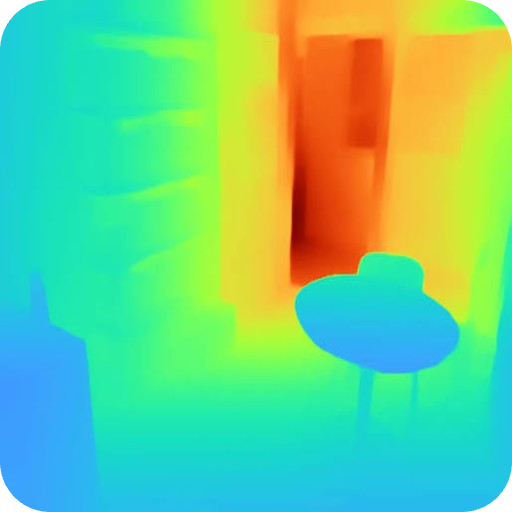
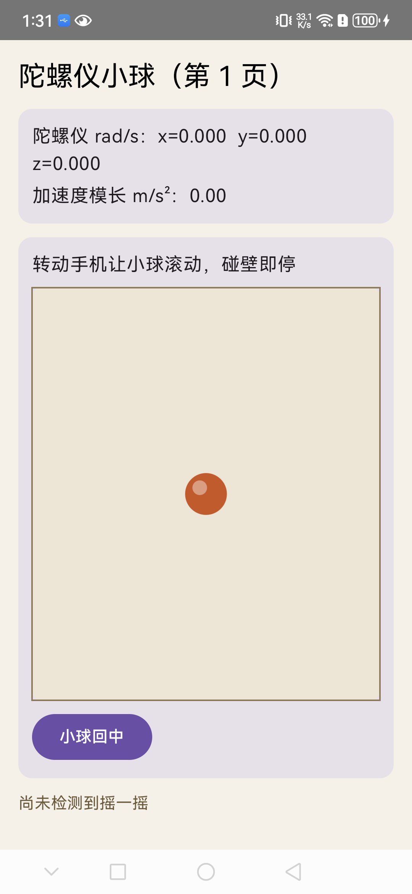
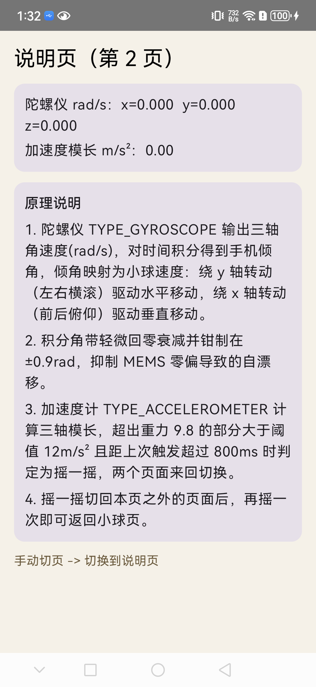
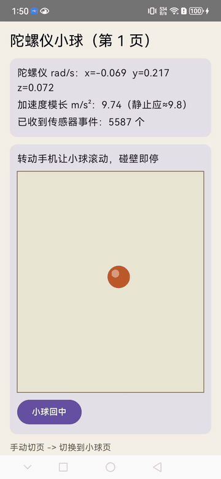

<p align="center">
  
</p>

# RobotSuitZulu — 玑函
* 手机机器人实验工具箱

把手机变成一台“会看、会算、会思考”的机器人实验平台：摄像头、IMU、算力、屏幕、网络全部端上闭环，不需要外接工控机，也不依赖云端推理。

## 为什么是手机

| 维度 | 手机 | 传统工控机 + 深度相机 |
| --- | --- | --- |
| 成本 | 一台旧手机即可 | 数千元起步 |
| 部署 | 装个 App | 驱动、标定、线缆一堆 |
| 传感器 | 摄像头 + IMU + ToF/激光雷达（部分机型） | 需单独采购 |
| 算力 | NPU / GPU / DSP，几十 TOPS | 常需外接 |
| 形态 | 随手可得、可挂到小车上 | 体积大 |

本项目把机器人感知与决策栈整体搬到手机端，用于教学实验、算法验证与快速原型。

## 核心能力

### 1. 端侧深度估计（On-device Depth Estimation）

- 单目深度：基于轻量 CNN / Transformer 的相对深度模型（TFLite / ONNX / Core ML）
- 双目 / 结构光：调用系统原生深度 API（ARKit Depth、ARCore Depth API）
- 融合深度：视觉深度 + IMU + LiDAR（机型支持时）做尺度校正与滤波
- 输出：逐像素深度图、点云、鸟瞰图（BEV），可直接喂给避障与建图模块

### 2. 端侧 SLAM（On-device SLAM）

- 视觉惯性里程计（VIO）：摄像头 + IMU 紧耦合，实时输出 6DoF 位姿
- 稀疏 / 半稠密建图：特征点地图、关键帧数据库、回环检测
- 稠密地图：TSDF / OctoMap / 3DGS 体素地图，用于导航与重建
- 对外接口：标准位姿 / 地图话题，可与 ROS2、小车底盘、机械臂联动

### 3. 端侧深度学习（On-device Deep Learning）

- 推理后端：TFLite、ONNX Runtime、Core ML、NCNN、MNN、厂商 NPU SDK
- 感知任务：目标检测（YOLO 系列）、语义 / 实例分割、OCR、姿态估计
- 加速手段：量化（INT8/FP16）、算子融合、NPU/GPU 委托、模型蒸馏
- 端上数据闭环：采集 → 标注 → 增量训练 → 量化 → 回灌部署，全在手机完成

### 4. 端侧自进化具身模型（On-device Self-evolving Embodied Model）

- 记忆：场景特征库 + 语义拓扑图，跨会话持久化
- 学习：在线自监督（对比学习、聚类新物体）、经验回放与技能库
- 决策：轻量 VLM / LLM（GGUF、Qwen 系列小模型）做任务规划与场景问答
- 进化：失败样本自动回流 → 端上微调（LoRA / Adapter）→ 模型热更新
- 闭环：感知（深度 + 检测）→ 建图（SLAM）→ 规划 → 执行（串口 / BLE 控制底盘）

## 联动项目

本工具箱的感知与通信底座复用/对接以下两个 Rust 生态项目：

| 项目 | 定位 | 在本工具箱中的角色 |
| --- | --- | --- |
| [slambook2.rs](https://github.com/ByeIO/slambook2.rs) | 《视觉 SLAM 十四讲》（slambook2）的 Rust 重构，覆盖几何、李代数、特征法/直接法 VO、BA、回环、稠密建图等 1–13 章算法，并提供 wasm 预构建版本 | 算法底座：提供相机模型、位姿求解（PnP / 对极几何）、曲线拟合与轨迹表示等基础算子，供端侧 SLAM 与二维码定位复用 |
| [bye.rosette.rs](https://github.com/ByeIO/bye.rosette.rs) | Rosette（玫瑰之心）：纯 Rust 实现的 ROS2 风格机器人框架，支持 DDS 分布式通信、topic/service/action、rosbag、webviz 等 | 通信中间件：手机端位姿、路径、检测结果以标准话题发布，与桌面端可视化、底盘控制节点互联（跨机可用 EasyTier 组网） |

典型链路：手机相机帧 → 二维码/特征检测（本仓库 `apps/`）→ 位姿求解（slambook2.rs 算子）→ 路径规划 → 通过 Rosette 话题发布 → 底盘执行 + 屏幕叠加显示预测路径。

## 规划实验

### 实验一：基于二维码的引导定位（QR-guided Localization）（已实现）✅

> 联动 [slambook2.rs](https://github.com/ByeIO/slambook2.rs) + [bye.rosette.rs](https://github.com/ByeIO/bye.rosette.rs)（话题输出规划中）；纯 Kotlin + Jetpack Compose + CameraX + ZXing，识别方法参照 WaveSend——工程位于 [`sections/exp1-qrcode-pose-estimate/`](sections/exp1-qrcode-pose-estimate/)，并已集成为主 app 的「二维码定位」标签页

**目标**：识别场景中的二维码（支持同帧多码、任意可识别尺寸），根据透视畸变估计相机（机器人）相对码面的位姿，并生成一条到达**最近二维码**的路径，以**蓝色曲线**实时绘制在预览画面上。

**流程**：

1. **检测**：CameraX `ImageAnalysis` 逐帧送 ZXing `GenericMultipleBarcodeReader` 多码解码（Hybrid → Global 直方图两级候选二值化）；由 3 个定位图案中心按平行四边形模型推算第 4 角
2. **位姿估计**：四角像素 ↔ 已知物理边长的平面方形做 4 点 DLT 求单应矩阵（h33=1，8×8 高斯消元），分解 `H = [r1 r2 t]` 得相机系位姿 `T_cw`（Gram-Schmidt 正交化 + z 正向约束），按码内容做 EMA 平滑抑制抖动
3. **路径规划**：相机系下从镜头前方到最近二维码中心的三次贝塞尔曲线
4. **可视化**：每个码画绿色锁定框 + 内容标签，蓝色路径曲线 + 红色目标点指向最近码；顶部状态条实时显示检出数量与最近码内容 / 距离
5. **联动输出**（规划中）：位姿经 slambook2.rs 的 SE(3) 类型规整后，打包为 `geometry_msgs/PoseStamped` 话题，由 Rosette 发布，webviz / 底盘节点订阅执行

**预期效果**：手机对着墙上的二维码缓慢移动，画面中蓝色曲线始终平滑地"指向"并延伸至二维码中心；同帧多码时自动锁定最近的一个，路径实时跟随重算。

**用到的 slambook2.rs 知识点**：相机模型与内参（ch5，固定 62° 视场角近似）、单应与位姿估计（ch7，单应分解替代 EPnP）。

**已知限制**：角点取自定位图案中心（非码面真实角点）、内参未标定，位姿精度为演示级，距离为相对量；详细说明见 [section README](sections/exp1-qrcode-pose-estimate/README.md)。

### 实验二：IMU 小球 + BLE 遥控 esp32（已实现）✅

> 纯 Kotlin + Jetpack Compose，无第三方 BLE 库；工程位于 [`sections/exp2-switch-page-imu/`](sections/exp2-switch-page-imu/)

**目标**：一个 App 演示三件事——陀螺仪姿态感知、摇一摇交互、手机经 BLE 遥控 esp32 小车/小灯。

**功能**：

1. **陀螺仪小球页**：`TYPE_GYROSCOPE` 角速度对时间积分得手机倾角（带回零衰减抑制 MEMS 零偏），倾角映射为小球速度，转动手机让小球在边界框内滚动
2. **摇一摇切页**：`TYPE_ACCELEROMETER` 三轴模长超出重力阈值（12 m/s²，冷却 800ms）判定为摇一摇，在小球页 → 说明页 → 遥控页间循环切换
3. **BLE 遥控页**（复刻传统 XML 布局的 Compose 版本）：
   - 纯 Android BLE API（`BluetoothLeScanner` + `BluetoothGatt` + CCCD 通知），替代 RxBLE/RxJava 封装
   - 扫描连接 esp32 的 Nordic UART 服务（`6E400001-...`，RX 写指令 / TX 收通知）
   - Compose Canvas 虚拟手柄：拖拽判定主方向（forward/backward/left/right），1 秒消抖后写入指令帧；连接成功自动翻转 esp32 小灯
   - 顶部导航栏 / 中部状态区（电量、速度、旋转角度）/ 底部日志区（25 行时间戳日志，自动滚底），马卡龙配色

**演示**：

| 小球页 | 说明页 | 摇一摇切页动图 |
| --- | --- | --- |
|  |  |  |

**esp32 端固件**：[esp32笔记[6]-蓝牙(BLE)控制小灯](https://www.cnblogs.com/qsbye/p/17566976.html)

### 实验三：AR 画线（FOSS 版 Just a Line）✅

> 纯 Kotlin + Jetpack Compose + CameraX + 传感器，净室重写自 [逆向分析报告](reference/justaline/20261019-074718-JustaLine_逆向分析报告.md)，工程位于 [`sections/exp3-ar-draw-line/`](sections/exp3-ar-draw-line/)

**目标**：复刻 Google AR Experiments 的空间绘画应用 Just a Line——转动手机瞄准，按住屏幕拖动即可在空中画线——并把原版绑定的专有服务（ARCore / Firebase / Nearby / GMS）全部替换为开源栈，可在无 GMS 设备上运行。

**FOSS 改造**：

1. **3DoF magic-window 追踪替代 ARCore**：游戏旋转矢量传感器输出设备→世界旋转矩阵 R，笔画点存世界系坐标，每帧用 Rᵀ 重投影到屏幕，实现"线留在空气中"；触摸射线按针孔模型落到固定距离（近/中/远 0.7/1.5/3 m）的平面上
2. **Compose Canvas 替代 OpenGL 渲染器**：2D 线段 + 透视线宽（近粗远细）近似原版 GL 三角带，保留原版 finishStroke 的微小笔画处理逻辑
3. **零遥测零网络**：移除 Firebase Analytics / FCM / Nearby 协作，仅申请相机权限；视频录制降级为 PNG 快照导出（相册 `Pictures/RobotSuitZulu-AR`）
4. **8 色色板 + 三档笔宽 + 撤销/清空 + 追踪状态指示灯**，无相机权限时降级为深色背景天空画线模式

**已知限制**：3DoF（无平移视差）、旋转矢量长时缓慢漂移、FOV 为 62° 近似值——详见 [section README](sections/exp3-ar-draw-line/README.md)。

### 实验四：端侧单目深度估计（On-device Monocular Depth Estimation）🚧

> 参考 [DepthART](https://github.com/AIRI-Institute/DepthART)（arXiv:2409.15010，MIT License）——原仓库已存档至 [`reference/DepthART-main/`](reference/DepthART-main/)

**目标**：把 DepthART「单目深度估计 = 自回归细化任务」的范式搬到手机端——复用图像生成模型 VAR 的下一尺度预测先验，端上实时输出逐像素相对深度，伪彩色深度图叠加相机预览，并与实验一的二维码位姿联动做绝对尺度校正。

**原理**（DepthART 的三层拆解）：

1. **深度离散化**：预训练 VQ-VAE（`vae_ch160v4096z32`）把深度图编码为多尺度 token 金字塔——从 1×1 的全局摘要到细尺度的局部细节
2. **自回归细化**：VAR d16 以 RGB 图像为条件，按尺度从粗到细逐级预测深度 token；DepthART 的关键改动是把任务定义为「细化」——上一尺度的粗糙深度在下一尺度被修正补全而非从零生成，让生成先验与深度回归任务对齐
3. **解码还原**：VQ-VAE 解码器将最细尺度 token 还原为连续深度图

**流程**：

1. **复现训练**：Hypersim 合成数据集 + 官方预训练权重（VQ-VAE / VAR d16），`tools/dist_train.sh train_depthART.yaml` 训练；`tools/eval.py` 在 NYUv2 / ETH3D / iBims-1 / TUM 上复算 AbsRel、δ<1.25 并与论文对齐
2. **端侧转换**：PyTorch → ONNX 导出 → FP16 / INT8 量化 → ONNX Runtime Mobile / TFLite（NNAPI / NPU 委托）；延迟超标时蒸馏到更小骨干
3. **端侧推理**：CameraX 逐帧 → letterbox 预处理 → 推理 → 深度图上采样对齐
4. **可视化**：turbo 伪彩色深度图实时叠加预览，原图 / 深度 / 混合三档切换
5. **联动输出**：与实验一联动——二维码已知物理边长提供绝对尺度，将相对深度校正为米制深度；深度图规整为点云 / BEV，经 Rosette 以 `sensor_msgs/Image` 话题发布，供避障与建图节点订阅

**预期效果**：手机对准室内场景，伪彩色深度图实时跟随（近暖远冷，遮挡边界清晰）；场景中放置二维码后，深度读数经尺度校正接近米制真值——实验一的几何位姿与实验四的学习深度互相校验。

**对照与知识点**：经典几何法单目稠密重建（slambook2.rs ch12 极线搜索 + 深度滤波）对照生成式学习法（VQ token + 自回归 Transformer）；端侧量化部署（INT8 / FP16、NPU 委托）。

**已知限制**：单目深度本质为相对量，绝对尺度依赖外部校正（实验一联动补齐）；VAR d16 + VQ-VAE 参数量对中端机型有压力，需在精度与帧率间权衡。

## 目录结构

```
.
├── apps/                  # 手机端 App（Android / iOS）
│   ├── camera/            # 相机采集与标定
│   ├── depth/             # 深度估计模块
│   ├── slam/              # SLAM 与位姿输出
│   ├── inference/         # 深度学习推理引擎封装
│   └── embodied/          # 自进化具身决策模块
├── models/                # 端侧模型与转换脚本（tflite/onnx/gguf）
├── bridge/                # 手机 ↔ 机器人底盘 / ROS2 通信桥
├── datasets/              # 实验数据集与标注工具配置
├── experiments/           # 可复现实验脚本与结果
└── docs/                  # 原理、实验指导书、API 文档
```

## 快速开始

```bash
# 克隆仓库及联动项目
git clone <repo-url>
cd <repo-dir>
git clone https://github.com/ByeIO/slambook2.rs      # 算法底座
git clone https://github.com/ByeIO/bye.rosette.rs    # 通信中间件

# Android：构建并安装实验 App
cd apps/android && ./gradlew installDebug

# iOS：用 Xcode 打开工程直接运行
open apps/ios/PocketBot.xcodeproj

# 下载端侧模型
cd models && ./download.sh

# 连接机器人底盘（可选，串口 / BLE）
cd bridge && cargo run -- --port /dev/ttyUSB0
```

## 典型实验

1. **深度估计算验**：拍摄室内场景，对比单目 / 双目深度精度（AbsRel、δ<1.25）
2. **VIO 轨迹评估**：手持或装到小车上绕行一圈，输出轨迹并与真值比对
3. **实时检测 + 避障**：YOLO 端上检测 + 深度图投影，实现跟随 / 避障小车
4. **场景记忆与问答**：对着桌面物体提问“这是什么”，模型结合记忆作答
5. **自进化闭环**：连续多天在同一场景运行，观察新物体类别的增量发现与准确率变化

## 性能参考（中端手机，2024 机型）

| 模块 | 模型 | 延迟 | 说明 |
| --- | --- | --- | --- |
| 单目深度 | MiDaS-small INT8 | ~18 ms | 256×256 输入，NPU |
| 目标检测 | YOLOv8n INT8 | ~12 ms | 320×320 输入，NPU |
| VIO | 自研前端 | ~25 ms | 640×480，CPU+DSP |
| 语义分割 | DeepLabV3-small | ~30 ms | 384×384，GPU |

> 以上为量级参考，具体数值随机型与后端变化，复现脚本见 `experiments/`。

## 路线图

- [ ] 多机协同：两台手机互为观测节点做分布式 SLAM
- [ ] 端云协同：弱网下端侧自治、联网时云端蒸馏下发
- [ ] 更多底盘适配：ROS2、Micro-ROS、串口 PWM
- [ ] 端侧扩散模型：用于物体抓取位姿生成

## 依赖与环境

- Android 10+（推荐支持 NNAPI / 厂商 NPU 的机型）
- iOS 16+（推荐带 LiDAR 的 Pro 机型）
- 可选：ROS2 Humble、Rust 1.75+、Python 3.10+

## 许可证

本仓库主体代码以 [MIT License](LICENSE) 授权，Copyright (c) 2026 qsbye。

仓库中收录的第三方内容（参考工程、应用存档、文章存档等）**不属于** MIT 覆盖范围，版权归原作者，明细见 [NOTICE.md](NOTICE.md)。

欢迎 Issue 与 PR 交流实验复现问题。
